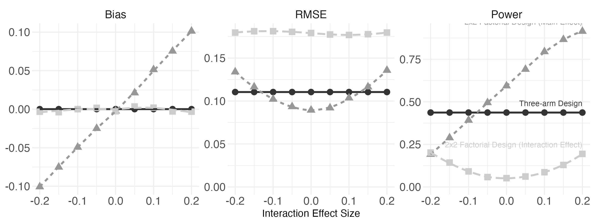
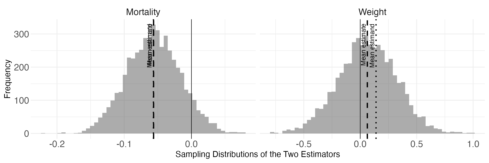

# Reproducibility Report: Blair, Cooper, Coppock and Humphreys (2019)


- [Paper Overview](#paper-overview)
- [Summary](#summary)
  - [Does the deposited archive run?](#does-the-deposited-archive-run)
  - [Does the maintained rewrite reproduce the
    paper?](#does-the-maintained-rewrite-reproduce-the-paper)
- [Original Archive Reproducibility](#original-archive-reproducibility)
- [Errata](#errata)
- [What Moved Underneath the Code](#what-moved-underneath-the-code)
- [Where the Article Disagrees With
  Itself](#where-the-article-disagrees-with-itself)
- [Ground Truth Verification](#ground-truth-verification)
  - [The disagreements](#the-disagreements)
- [Maintained Rewrite](#maintained-rewrite)
- [Figure Verification](#figure-verification)
- [Maintained Rewrite Verification](#maintained-rewrite-verification)
- [R Environment](#r-environment)

*Drafted by Claude Opus 5 under the supervision of Alex Coppock.*

This repository holds the actively maintained replication code for
Blair, Cooper, Coppock and Humphreys (2019), together with the
reproducibility report that documents what the original archive did and
did not do. It is part of a program applying the maintenance proposal in
Peer, Orr and Coppock (2021, *PS: Political Science & Politics*, doi
[10.1017/S1049096521000366](https://doi.org/10.1017/S1049096521000366))
to a set of published archives.

|  |  |
|----|----|
| Article | [10.1017/S0003055419000194](https://doi.org/10.1017/S0003055419000194) |
| Replication archive | [10.7910/DVN/XYT1VB](https://doi.org/10.7910/DVN/XYT1VB) |

**The deposit is not redistributed here.** It lives at Harvard Dataverse
and that is the only copy this repository points at.
`download_original.R` fetches it, unpacks it, and verifies it;
`verify_original.R` holds the checks and runs both before and after a
full reproduction.

The deposit is a single zip file, so a check that `original/` contains
nothing the manifest does not list is a check on one file and says
nothing about what is inside it. The repository therefore carries two
manifests. `original_manifest.csv` records the archive file itself: its
Dataverse file identifier, its byte size, and two checksums, the MD5 of
the bytes Dataverse serves for `?format=original` and the MD5 Dataverse
publishes. `original_members_manifest.csv` records the size and MD5 of
every one of the 620 members inside it. The zip is unpacked into
`original_extracted/`, which `download_original.R` rebuilds from scratch
on every run and nothing else writes to. Both directories are absent
from version control and both are verified by size and checksum, so the
exact bytes are pinned even though the bytes themselves are not.

**Repository layout.** `maintained/` is the maintained rewrite: one
script per published table or figure, writing to `output/`, which is
committed so a reader can compare a fresh run against it without
downloading anything. `ground_truth/` ties every published number to the
code that produces it, and also runs the deposited code and records what
happens. This README is the reproducibility report, also available as a
PDF in `report/`.

**License.** CC0 1.0 Universal, matching the terms of the deposit this
repository maintains, so nothing in the chain is more restrictive than
the archive itself. See `LICENSE`.

**To reproduce.** Clone or download the repository, open
`blair_cooper_coppock_humphreys_2019.Rproj`, and run:

``` r
source("run_all.R")
```

That fetches the deposited archive from Dataverse, verifies it, and
produces every table and figure into `maintained/output/`, then rebuilds
the ground truth and re-verifies the deposit. Every diagnosis uses the
published 5000 simulations and 5000 bootstrap replicates. Individual
scripts can be run on their own in a fresh session, in any order, with
two exceptions: `figure_2_bs_sampling_distributions.R` reads the
simulations written by `table_a19_bs_diagnosis.R`, and
`figure_1_experimental_designs.R` must not run in a session where the
QCA appendix table has already run. That second constraint is asserted
in the script rather than left to the order of the driver, and the
reason is under What Moved Underneath the Code below.

Required packages: DeclareDesign, DesignLibrary, estimatr, QCA,
Matching, tidyverse, future, readxl, broom, knitr, kableExtra, here.
Paths resolve through `here`, so nothing depends on the working
directory. A successful run overwrites `maintained/output/`, which is
committed: **`git diff` on that folder is the reproduction check**, and
the CSV output should come back byte-identical. The figure PDFs always
show as changed, because a PDF records the time it was written; compare
their PNG twins instead.

## Paper Overview

**Citation**: Blair, G., Cooper, J., Coppock, A. and Humphreys, M.
(2019). Declaring and diagnosing research designs. *American Political
Science Review*, 113(3), 838-859.

**Research question**: Can a research design, quantitative or
qualitative, be written down formally enough that its properties can be
computed before the study is run, and what does that formalization
reveal that informal design description hides?

**Design**: The paper is methodological rather than empirical. It
proposes that a design is fully described by four elements, a model M,
an inquiry I, a data strategy D and an answer strategy A, and that once
all four are declared in code, any diagnosand (bias, RMSE, power,
coverage, an exaggeration ratio, a posterior shift) is a simulation
away. The argument is carried by two kinds of evidence. First, a census
of 30 existing design tools against a single blocked working example,
showing which elements of that design each tool can express. Second, a
set of worked declarations spanning survey sampling, Bayesian
descriptive inference, process tracing, qualitative comparative
analysis, nested mixed methods, observational regression, matching,
regression discontinuity, factorial and three-arm experiments, and
discovery research, each diagnosed by Monte Carlo simulation. The paper
closes with a design replication of Björkman and Svensson (2009),
diagnosing the original study’s properties without using its data.

**Main finding**: Formal declaration exposes design properties that are
invisible otherwise. No surveyed tool can declare a correlation between
block sizes and effects, an estimand, a sampling strategy, an assignment
procedure or probability weighting, and none can report bias, coverage
or the standard deviation of estimates. In the design replication, an
estimator that appears unbiased for child mortality is shown to
exaggerate the effect it detects by roughly a factor of two once
attention is limited to statistically significant results, and the
weight-for-age estimator is shown to be biased downward by the very
mortality effect the study reports.

------------------------------------------------------------------------

## Summary

Two questions, answered before the detail.

### Does the deposited archive run?

No. None of its 15 scripts runs to the end, in either pass, and for
fourteen of them the cause is the same: the deposit is written against
the version of DeclareDesign that existed when the paper was published,
and the package’s interface changed at version 1.0.

The failures are not a matter of a deprecated name still working with a
warning. `declare_estimand()`, `declare_population()` and
`declare_reveal()` all still exist, and a script that used only those
would run. What does not survive is the argument structure.
`declare_sampling(n = 100)` and
`declare_assignment(blocks = block, m = 10)` no longer describe a
sampling or an assignment, `declare_estimator(model = lm_robust)` no
longer names an estimation method, and `Z_cond_prob`, which the working
example’s inverse probability weighted estimator divides by, is no
longer attached to the data at all. Fourteen of the fifteen stop at the
first of these they reach.

The fifteenth is the experimental design script behind Figure 1, and it
is the only one built entirely from `DesignLibrary` designers rather
than from hand-written declarations, so the interface change does not
touch it. It reaches the ten minute limit this harness gives each script
and is recorded as unfinished, because it recomputes ten diagnoses at
5000 simulations first. Run separately at a reduced simulation count so
that it gets past them, it stops at
`write_rds(diagnosis_1, path = path_to_file_1)` with
`argument "file" is missing, with no default`: `readr` renamed that
argument, and the rename is an error rather than a warning. So it fails
too, one step later than the others.

Three consequences are worth separating from the failure itself.

**The deposit ships its own results, and it recomputes them anyway.**
Every analysis script computes a diagnosis, writes it to `rds_files/`,
and then reads it straight back before printing, and those saved objects
are in the deposit, one per diagnosis at the published 5000 simulations.
Whether a script computes or merely loads is controlled by a flag, and
the deposit’s own driver sets it to recompute, which is what the passes
here do as well. Both passes are reported below regardless: 0 of 15
scripts complete as shipped and 0 of 15 complete once those saved
objects are removed. The distinction does not separate anything here
only because nothing gets far enough for it to matter.

**Those saved objects are what makes this paper checkable at all.** They
hold the numbers behind every published table at full precision,
computed by the authors’ own code under the packages of its day, and
they are the source of the deposit’s column in the ground truth below.

**Running the deposit where it sits would damage it.** The deposit
contains 25 uncommented calls that write to disk, and its own driver
script, `run_replication.R`, opens a sink into `output/` for each script
before sourcing it and writes figures into `figure/`. Every file in
`output/`, `figure/` and `rds_files/` is itself a deposited member, so
running that driver in place would truncate part of the deposit before
any analysis ran. Both passes here run in scratch copies under the
session’s temporary directory and drive the scripts directly rather than
through `run_replication.R`. The number of deposited files either pass
actually modifies is 0, which is what a run that stops at its first
declaration leaves behind, and the second verification step of
`run_all.R` re-checks all 620 members against the manifest after
everything has finished.

### Does the maintained rewrite reproduce the paper?

Yes at the level of the analysis, and the arithmetic of the answer needs
a word of explanation. Of 306 published claims drawn from the article
and its appendix, 268 can be compared against the rewrite and 170 of
them agree at the precision the article prints.

The 98 that do not have one main cause: 61 of them differ by a single
unit in the last digit the article prints, and in 91 cases the deposit’s
own saved diagnosis reproduces the published value exactly. Every
diagnosis in this paper is a Monte Carlo simulation of 5000 draws, so a
proportion carries a simulation standard error of roughly 0.007 and a
table printed to two decimals cannot be reproduced digit for digit
except by drawing the same 5000 samples. The rewrite sets the deposit’s
own seed and the current DeclareDesign draws a different sample from it.
Those rows carry `environment` below, and they are not a failure of
either analysis.

The other 39 rows that carry a recorded fault are where the interest is,
and they are listed individually further down. They include the claims
the rewrite is not expected to answer at all, which are counted here
rather than left in the unverifiable bucket without a reason.

| Claim type   | Claims | Comparable | Agree | Differ |
|:-------------|-------:|-----------:|------:|-------:|
| pipeline     |    255 |        253 |   158 |     95 |
| definitional |     26 |          0 |     0 |      0 |
| descriptive  |     15 |         15 |    12 |      3 |
| structural   |      5 |          0 |     0 |      0 |
| transcribed  |      5 |          0 |     0 |      0 |

Published claims by type

`pipeline` claims are numbers the code must produce. `descriptive`
claims are statements about shape, sign or order (that one estimator is
less biased than another, that a line rises) which carry no printed
value and are evaluated here as computed truth values. `definitional`
claims are design parameters and conventions the article states,
`structural` claims describe the document rather than a result, and
`transcribed` claims are numbers copied from other papers.

| Where the fault lies | Claims |
|:---------------------|-------:|
| environment          |     80 |
| archive              |     14 |
| paper_internal       |      5 |
| unresolved           |      1 |

Disagreements between the rewrite and the article

`environment` means a package moved under code that did not change.
`archive` means the deposit cannot support the claim, through its code
or its data. `paper_internal` means the article disagrees with its own
tables. `unresolved` means the cause has not been established, which is
recorded rather than guessed at.

The deposit’s own saved results say something sharper from the other
side. 240 of the 246 claims for which the deposit carries a comparable
number agree with what the article printed, and every one of the 6 that
do not is a sentence rather than a table cell.

| Float or section | Claim | Published | Deposit | Rewrite | Fault |
|:---|:---|:---|:---|:---|:---|
| Appendix S3.1.2 | Percentage reduction in posterior standar… | 40% | 35% | 35% | paper_internal |
| Appendix S3.1.2 | Percentage increase in bias under informa… | 33% | 1425% | 1439% | paper_internal |
| Appendix S2.1 | Population average treatment effect of th… | 0.406 | 0.409 | 0.410 | unresolved |
| Appendix S4.7 | Interact CBO has the highest RMSE of the … | TRUE | FALSE | FALSE | paper_internal |
| Appendix S4.5 | Mean mortality estimand as stated in prose | 0.006 | -0.057 | -0.057 | paper_internal |
| Appendix S4.5 | Share of simulations returning a signific… | 0.001 | 0.291 | 0.296 | paper_internal |

Every published value the deposit’s own saved results do not reproduce

------------------------------------------------------------------------

## Original Archive Reproducibility

| Script | Pass | Completed | Stopped at |
|:---|:---|:---|:---|
| 1_simple_design.R | As shipped | no | Error: You appear to have used legacy declare_sampling() syntax. Co… |
| 1_simple_design.R | Stripped | no | Error: You appear to have used legacy declare_sampling() syntax. Co… |
| 2_design_census.R | As shipped | no | Error: You appear to have used legacy declare_sampling() syntax. Co… |
| 2_design_census.R | Stripped | no | Error: You appear to have used legacy declare_sampling() syntax. Co… |
| 3_10_discovery.R | As shipped | no | Error: You appear to have used legacy declare_assignment() syntax. … |
| 3_10_discovery.R | Stripped | no | Error: You appear to have used legacy declare_assignment() syntax. … |
| 3_1_survey_designs.R | As shipped | no | Error: You appear to have used legacy declare_sampling() syntax. Co… |
| 3_1_survey_designs.R | Stripped | no | Error: You appear to have used legacy declare_sampling() syntax. Co… |
| 3_2_Bayesian_descriptive_inference.R | As shipped | no | Error: You appear to have used legacy declare_sampling() syntax. Co… |
| 3_2_Bayesian_descriptive_inference.R | Stripped | no | Error: You appear to have used legacy declare_sampling() syntax. Co… |
| 3_3_process_tracing.R | As shipped | no | Error: You appear to have used legacy declare_sampling() syntax. Co… |
| 3_3_process_tracing.R | Stripped | no | Error: You appear to have used legacy declare_sampling() syntax. Co… |
| 3_4_QCA.R | As shipped | no | Error in file(file, …) : argument “file” is missing, with no default |
| 3_4_QCA.R | Stripped | no | Error in file(file, …) : argument “file” is missing, with no default |
| 3_5_nested.R | As shipped | no | Error in knitr::include_graphics(“figure/Nested_analysis.pdf”) : |
| 3_5_nested.R | Stripped | no | Error in knitr::include_graphics(“figure/Nested_analysis.pdf”) : |
| 3_6_model_based_estimands.R | As shipped | no | Error: You appear to have used legacy declare_assignment() syntax. … |
| 3_6_model_based_estimands.R | Stripped | no | Error: You appear to have used legacy declare_assignment() syntax. … |
| 3_7_matching.R | As shipped | no | Error: object ‘bias’ not found |
| 3_7_matching.R | Stripped | no | Error: object ‘bias’ not found |
| 3_8_regression_discontinuity.R | As shipped | no | Error in file(file, …) : argument “file” is missing, with no default |
| 3_8_regression_discontinuity.R | Stripped | no | Error in file(file, …) : argument “file” is missing, with no default |
| 3_9_experimental.R | As shipped | no | Did not finish within 600 seconds. |
| 3_9_experimental.R | Stripped | no | Did not finish within 600 seconds. |
| 4_B_and_S_replication.R | As shipped | no | Error: You appear to have used legacy declare_sampling() syntax. Co… |
| 4_B_and_S_replication.R | Stripped | no | Error: You appear to have used legacy declare_sampling() syntax. Co… |
| appendix_code.R | As shipped | no | Error: You appear to have used legacy declare_sampling() syntax. Co… |
| appendix_code.R | Stripped | no | Error: You appear to have used legacy declare_sampling() syntax. Co… |
| table_3_declaration.R | As shipped | no | Error: You appear to have used legacy declare_sampling() syntax. Co… |
| table_3_declaration.R | Stripped | no | Error: You appear to have used legacy declare_sampling() syntax. Co… |

Every deposited script, run both ways

**The archive carries two seeds.** `run_replication.R` sets
`set.seed(90095)` before its loop, and every script it sources then
sources `knitr_setup.R`, which sets `set.seed(90405)`. The second is
therefore the seed each deposited script actually runs under, and it is
the seed the rewrite uses.

**What the deposit does supply is its own output.** Because it saves
every diagnosis at the published simulation count, the numbers behind
every appendix table can be read from the deposit at full precision
without running anything. `ground_truth/extract_archive_values.R` reads
them, and they are the `value_script` column of the ground truth. That
is what makes a three-way comparison possible here: the article’s
printed number, the deposit’s saved number, and the rewrite’s fresh
computation.

------------------------------------------------------------------------

## Errata

The rewrite corrects two errors in the deposited code. Neither is an
analytical choice; both are cases where the deposited code does not do
what the surrounding text says it does.

**The QCA truth table reads a column that does not exist.** `3_4_QCA.R`
passes `outcome = "Y_Obs"` to `truthTable()`, while the column the
design creates is `Y_obs`. Under the current QCA package that spelling
sends every call into the deposit’s own `tryCatch` and returns
`NO SOLUTION` for all of them, which would make both algorithms’ failure
rate 1.00. The appendix prints failure rates of 0.07 and 0.00, and
prints a single draw of the estimates in which both algorithms return
`B`, so the deposited spelling cannot be what produced the published
table. The rewrite uses the column’s own name.

**The Bayesian design’s sample size is not reachable by `redesign()`.**
`3_2_Bayesian_descriptive_inference.R` writes the sample size as a
literal inside `declare_sampling()` and then calls
`redesign(bayesian_design, n = c(10, 100))`. The redesigned n = 100
design therefore samples ten units, exactly as the n = 10 design does.
The published table shows this directly: its n = 10 and n = 100 rows are
identical to two decimal places in all five columns. The rewrite names
the sample size so that `redesign()` reaches it, which is what the
published column headings say the table varies. A second table has the
same shape and is treated differently below, because there the
declaration needs no change and the current package reaches the
parameter on its own.

------------------------------------------------------------------------

## What Moved Underneath the Code

Five changes in packages, none of them errors in the deposit, account
for most of what the rewrite does differently. Each was found by running
the code, not by reading a changelog.

**The QCA package’s notation for absence changed, and the diagnosand is
a string comparison.** The design’s inquiry is the configuration `a*B`,
written in the notation the article uses, where a lower case letter
means the condition is absent. QCA 3.25 writes the same configuration as
`~A*B`. The two diagnosands here are `mean(estimand == estimate)` and
`mean(estimate == "NO SOLUTION")`, so the change of notation alone
drives every correct rate to zero while leaving the failure rates
untouched, and it does so silently: nothing errors, and the table still
fills. The rewrite puts the estimator’s answer back into the inquiry’s
notation before the two meet.

**The two minimization algorithms the appendix compares now return the
same answer.** The design asks the classic Quine-McCluskey algorithm and
the consistency cubes algorithm for the sufficient configuration, and
the published tables show them differing: the classic algorithm fails to
return a solution more often. Under QCA 3.25 the two return the
identical solution in every one of the 5000 simulations, in all three of
the appendix’s QCA tables, so the rewrite’s consistency cubes column is
a copy of its classic column. The deposit’s saved diagnosis, computed
under the QCA of its day, distinguishes them. Nothing errors here
either.

**`redesign()` now reaches a value a handler closes over.** The nested
mixed methods design is diagnosed across three decision thresholds. Two
of them are read inside the body of a function passed as a handler. The
published table varies with the first threshold and not with the other
two: its eight rows take two distinct values, one for each setting of
the large-N threshold. The current `redesign()` does reach all three,
and the four rows at the high large-N threshold separate into a pair
near 0.05 and a pair near 0.64, with the published value sitting between
them. Running the same declaration with the large-N threshold high and
the two SNA thresholds left at the defaults the deposit declares returns
the four published rows at that setting to within simulation error,
which is what identifies the published table as varying one threshold
rather than three. The rewrite changes nothing in the declaration here,
so this belongs to the package rather than to the deposit.

**A neighbouring table redesigns on parameters that are in no version of
the design.** The same declaration is also diagnosed across the effort
spent on model testing and model building, and those two parameters are
used by sampling steps that the handler calls rather than by steps of
the design itself. `redesign()` cannot reach them, and the current
DeclareDesign says so in a warning as the rewrite runs. The four rows of
that table are four simulations of one design, in the deposit as much as
in the rewrite: the four published values differ by no more than
simulation error, which is what that structure predicts. The appendix
reads an ordering off them, that “increasing the effort devoted to
testing decreases our chances of happening on the right model,” and the
ordering is not an effect of effort.

**`QCA::simplify` is not exported, and was not exported when the paper
was written either.** The least squares answer strategy in the QCA
appendix passes its predicted configurations to `QCA::simplify` inside a
`try()`, so the call fails and the estimator returns `NO SOLUTION` on
every simulation. The published table says exactly that: the least
squares column is a failure rate of 1.00 and a correct rate of 0.00 in
all four of its panels. The rewrite reproduces the published column, and
it reproduces it for the same reason the deposit did.

**A package loaded for one table breaks an unrelated design for the rest
of the session.** The QCA package loads `declared`, whose load hook
writes over fourteen bindings in `base` and `stats`, among them
`base::rbind.data.frame()`, which afterwards errors on any list argument
that is not a data frame. `DesignLibrary::multi_arm_designer()`, which
declares the three-arm design behind Figure 1, assembles its estimates
with exactly that call. Figure 1 therefore cannot be diagnosed in a
session where QCA has been loaded, and the failure names a base function
far from the package that caused it.

Reaching QCA through its namespace does not avoid this: a load hook runs
on load, so the first `QCA::` call installs the replacements just as
`library(QCA)` would, and they last for the rest of the session. What
protects Figure 1 is that it runs before the QCA appendix table, and
`figure_1_experimental_designs.R` asserts that condition rather than
relying on the order of `run_all.R`. All fourteen were exercised on
ordinary inputs before and after the load, and all fourteen return what
the base versions return, `rbind.data.frame()` included when its
arguments are data frames. The single behaviour that changes is
`rbind.data.frame()` on an argument that is a plain list, which fails
with `object 'xideclared' not found`, and that is the call the three-arm
estimator makes.

------------------------------------------------------------------------

## Where the Article Disagrees With Itself

Four claims in the text are contradicted by the article’s own tables or
by both sets of code.

**The power of the mortality estimator is printed twice, differently.**
The table in appendix section 4.5 gives a power of 0.29. The sentence
below it reports that “only 0.1% of simulations returned a statistically
significant result.” The deposit’s saved diagnosis agrees with the
table.

**The interaction strategy is not dominated.** The appendix says that
including the treatment-by-covariate interaction is “a strictly
dominated strategy from the standpoint of reducing mean squared error:
irrespective of whether CBO presence is correlated with health outcomes
or imbalanced, the RMSE expected under this strategy is higher than
under any other strategy.” The article’s own table prints a higher RMSE
for ignoring the covariate than for interacting with it when CBO
presence is correlated with outcomes. The deposit’s saved diagnosis and
the rewrite both agree with the table rather than with the sentence.

**Neither percentage in the Bayesian comparison is reachable.** The
article states that informative priors “decrease the posterior standard
deviation by 40% relative to the uniform priors, but increase the bias
by 33%.” Working from the deposit’s own saved diagnosis gives a smaller
reduction and an enormous increase, because the flat prior’s bias is
essentially zero, and the rewrite agrees with the deposit on both.

**The exaggeration ratio is defined at one threshold and computed at
another.** The appendix defines it as “the ratio of the average absolute
value of statistically significant estimates to the true effect, at the
a = 0.05 level.” The deposited diagnosand selects estimates on
`p.value < 0.1`. The rewrite keeps the deposit’s threshold, because it
is the estimator the published table was computed with, and records the
discrepancy rather than silently choosing one.

------------------------------------------------------------------------

## Ground Truth Verification

The appendix numbers none of its tables, so this report names each by
the section that prints it. The article’s own floats keep their numbers.
`ground_truth/published_claims.csv` is the transcription, hand-read from
the published PDF and the published appendix, and it is the only file in
the repository carrying a typed published value. Everything else is
computed: `ground_truth/extract_archive_values.R` reads the deposit’s
saved results, `ground_truth/build_ground_truth.R` reads
`maintained/output/`, and the comparison is made by printing the
computed number to the precision the article printed and comparing
digits.

The build stops rather than reporting a gap. A published float with no
claim, a claim that should have a computed counterpart and finds none,
and a disagreeing row with no recorded fault all halt it.

The transcription was checked by extracting every numeric token from the
published article and the published appendix and looking for tokens the
ground truth does not carry. What remains after that pass is section
numbers, page footers, citation years, and the model parameters the
appendix prints inside its code blocks, which the rewrite’s declarations
carry verbatim and which the claims file checks by name where the
surrounding prose states them. One published numeral is genuinely
uncovered: the appendix’s coding rules give the standard deviation of
the working example’s outcome as 1.01, no deposited script computes a
standard deviation of an outcome and no file in `maintained/output/`
carries one, so there is nothing to compare it against on either side.
The average treatment effect stated in the same sentence is covered, and
neither the deposit nor the rewrite reproduces it.

| Float or section | Claims | Comparable | Agree |
|:-----------------|-------:|-----------:|------:|
| Table 1          |      7 |          0 |     0 |
| Table 3          |      4 |          0 |     0 |
| Table 4          |      1 |          0 |     0 |
| Table 2          |     16 |         13 |    13 |
| Figure 1         |      5 |          2 |     2 |
| Appendix S3.2.1a |     22 |         18 |    11 |
| Appendix S3.2.2e |     25 |         24 |    18 |
| Appendix S4.5    |     18 |         11 |     7 |
| Appendix S4.6    |     14 |         11 |     5 |
| Appendix S4.7    |     26 |         25 |    16 |
| Appendix S3.1.2  |     27 |         27 |    16 |
| Appendix S3.2.2d |     17 |         17 |     7 |
| Figure 2         |      2 |          2 |     2 |
| Appendix S2.1    |     19 |         15 |     5 |
| Appendix S3.2.1b |      3 |          3 |     2 |
| Appendix S3.2.2c |      6 |          6 |     1 |
| Appendix S3.2.3a |     25 |         25 |    25 |
| Appendix S3.2.3b |      5 |          5 |     0 |
| Appendix S3.2.5  |      3 |          3 |     3 |
| Appendix S3.3    |     17 |         17 |    11 |
| Appendix S1      |      3 |          3 |     3 |
| Appendix S3.1.1  |      1 |          1 |     1 |
| Appendix S3.2.2a |      6 |          6 |     6 |
| Appendix S3.2.2b |      2 |          2 |     2 |
| Appendix S3.2.3c |      8 |          8 |     0 |
| Appendix S3.2.4  |     20 |         20 |    10 |
| Appendix S3.2.6  |      4 |          4 |     4 |

Coverage of every published float

### The disagreements

A disagreement of one unit in the last place the article prints is a
different kind of thing from a disagreement of ten, and the two are
separated here by measuring the gap rather than by asserting it.

Everything larger than one unit is listed in full below, with its reason
recorded in the `notes` column of the ground truth. Several of them are
still differences of simulation draw: the nested tables are printed to
four decimals, where the simulation error of 5000 draws is worth about
seventy units in the last place.

| Float or section | Claim | Published | Deposit | Rewrite | Fault |
|:---|:---|:---|:---|:---|:---|
| Table 2 | Table 2 reports 0 of the 30 admitted tool… | 0 | \- | \- | archive |
| Appendix S3.1.2 | Percentage reduction in posterior standar… | 40% | 35% | 35% | paper_internal |
| Appendix S3.1.2 | Percentage increase in bias under informa… | 33% | 1425% | 1439% | paper_internal |
| Appendix S2.1 | Population average treatment effect of th… | 0.406 | 0.409 | 0.410 | unresolved |
| Appendix S2.1 | Standard deviation of the working example… | 1.01 | \- | \- | archive |
| Appendix S3.2.2c | Consistency Cubes has a lower failure rat… | TRUE | TRUE | FALSE | environment |
| Appendix S3.2.3b | More effort on theory building and less o… | TRUE | TRUE | FALSE | archive |
| Appendix S4.7 | Interact CBO has the highest RMSE of the … | TRUE | FALSE | FALSE | paper_internal |
| Appendix S2.1 | Appendix S2.1, IPW-BFE: power | 0.72 | 0.72 | 0.74 | environment |
| Appendix S3.1.2 | Appendix S3.1.2, 100\|flat priors: mean_sd | 0.14 | 0.14 | 0.05 | archive |
| Appendix S3.1.2 | Appendix S3.1.2, 100\|flat priors: sd_shift | -0.15 | -0.15 | -0.24 | archive |
| Appendix S3.1.2 | Appendix S3.1.2, 100\|informative priors: … | 0.49 | 0.49 | 0.47 | archive |
| Appendix S3.1.2 | Appendix S3.1.2, 100\|informative priors: … | 0.09 | 0.09 | 0.05 | archive |
| Appendix S3.1.2 | Appendix S3.1.2, 100\|informative priors: … | 0.03 | 0.03 | 0.01 | archive |
| Appendix S3.1.2 | Appendix S3.1.2, 100\|informative priors: … | -0.01 | -0.01 | -0.03 | archive |
| Appendix S3.1.2 | Appendix S3.1.2, 100\|informative priors: … | -0.02 | -0.02 | -0.06 | archive |
| Appendix S3.2.1a | Appendix S3.2.1a, Update from both clues:… | 0.51 | 0.51 | 0.49 | environment |
| Appendix S3.2.2c | Appendix S3.2.2c, Consistency Cubes: fail… | 0.00 | 0.00 | 0.07 | environment |
| Appendix S3.2.2d | Appendix S3.2.2d, 0\|5\|Consistency Cubes: … | 0.01 | 0.01 | 0.12 | environment |
| Appendix S3.2.2d | Appendix S3.2.2d, 0.05\|5\|Consistency Cube… | 0.01 | 0.01 | 0.15 | environment |
| Appendix S3.2.2e | Appendix S3.2.2e, 0\|3\|Classic Quine-McClu… | 0.32 | 0.32 | 0.30 | environment |
| Appendix S3.2.2e | Appendix S3.2.2e, 0\|3\|Consistency Cubes: … | 0.05 | 0.05 | 0.30 | environment |
| Appendix S3.2.2e | Appendix S3.2.2e, 0.2\|3\|Consistency Cubes… | 0.10 | 0.10 | 0.44 | environment |
| Appendix S3.2.3b | Share of simulations reaching the New Mod… | 0.2780 | 0.2780 | 0.2698 | archive |
| Appendix S3.2.3b | Share of simulations reaching the New Mod… | 0.2858 | 0.2858 | 0.2736 | archive |
| Appendix S3.2.3b | Share of simulations reaching the New Mod… | 0.2782 | 0.2782 | 0.2870 | archive |
| Appendix S3.2.3b | Share of simulations reaching the New Mod… | 0.2752 | 0.2752 | 0.2748 | archive |
| Appendix S3.2.3c | Share of simulations reaching the New Mod… | 0.6424 | 0.6424 | 0.6292 | environment |
| Appendix S3.2.3c | Share of simulations reaching the New Mod… | 0.6270 | 0.6270 | 0.6274 | environment |
| Appendix S3.2.3c | Share of simulations reaching the New Mod… | 0.6244 | 0.6244 | 0.6306 | environment |
| Appendix S3.2.3c | Share of simulations reaching the New Mod… | 0.6242 | 0.6242 | 0.6386 | environment |
| Appendix S3.2.3c | Share of simulations reaching the New Mod… | 0.2840 | 0.2840 | 0.0530 | environment |
| Appendix S3.2.3c | Share of simulations reaching the New Mod… | 0.2748 | 0.2748 | 0.6350 | environment |
| Appendix S3.2.3c | Share of simulations reaching the New Mod… | 0.2740 | 0.2740 | 0.0508 | environment |
| Appendix S3.2.3c | Share of simulations reaching the New Mod… | 0.2738 | 0.2738 | 0.6356 | environment |
| Appendix S4.5 | Mean mortality estimand as stated in prose | 0.006 | -0.057 | -0.057 | paper_internal |
| Appendix S4.5 | Share of simulations returning a signific… | 0.001 | 0.291 | 0.296 | paper_internal |
| Appendix S4.6 | Appendix S4.6, bjorkman_svensson_design\|M… | 0.28 | 0.28 | 0.30 | environment |
| Appendix S4.6 | Appendix S4.6, RPP_replication\|Weight est… | 2.02 | 2.02 | 1.99 | environment |

Every disagreement of more than one unit in the last printed place

The remainder differ by exactly one unit in the last printed place and
are counted by the float they belong to.

| Float or section | Claims |
|:-----------------|-------:|
| Appendix S2.1    |      8 |
| Appendix S3.1.2  |      2 |
| Appendix S3.2.1a |      6 |
| Appendix S3.2.1b |      1 |
| Appendix S3.2.2c |      3 |
| Appendix S3.2.2d |      8 |
| Appendix S3.2.2e |      3 |
| Appendix S3.2.4  |     10 |
| Appendix S3.3    |      6 |
| Appendix S4.5    |      2 |
| Appendix S4.6    |      4 |
| Appendix S4.7    |      8 |

Claims differing only in the last printed digit

`maintained/in_text_claims.R` is the second instrument. It walks the
article and its appendix in reading order, carrying the sentence each
claim comes from in a comment beside the code, and computes the number
that backs it from `maintained/output/` directly. It never reads the
ground truth. The two therefore reach every claimed number by separate
paths, each doing its own selection and its own rounding, and the ground
truth build runs the second one and compares line by line. A
disagreement between them halts the build, because one of the two would
be wrong.

------------------------------------------------------------------------

## Maintained Rewrite

| Script | Role | Lines |
|:---|:---|---:|
| bs_design.R | The Bjorkman and Svensson declaration, sourced by three scripts | 109 |
| figure_1_experimental_designs.R | Article figure | 124 |
| figure_2_bs_sampling_distributions.R | Article figure | 46 |
| helpers.R | Packages, paths and the shared diagnosand writer | 60 |
| in_text_claims.R | Prints every published claim beside its computed counterpart | 1238 |
| table_2_tool_census.R | Article table | 88 |
| table_3_declaration.R | Article table | 68 |
| table_a1_simple_design.R | Appendix table | 45 |
| table_a12_nested_analysis.R | Appendix table | 175 |
| table_a15_model_based_estimands.R | Appendix table | 43 |
| table_a16_matching.R | Appendix table | 50 |
| table_a17_regression_discontinuity.R | Appendix table | 42 |
| table_a18_discovery.R | Appendix table | 90 |
| table_a19_bs_diagnosis.R | Appendix table | 34 |
| table_a2_working_example_census.R | Appendix table | 63 |
| table_a20_bs_exaggeration.R | Appendix table | 37 |
| table_a21_bs_covariate_adjustment.R | Appendix table | 94 |
| table_a3_survey_design.R | Appendix table | 40 |
| table_a4_bayesian_descriptive.R | Appendix table | 85 |
| table_a5_process_tracing.R | Appendix table | 137 |
| table_a7_qca.R | Appendix table | 148 |

Scripts in maintained/

Every diagnosis runs at the published 5000 simulations and 5000
bootstrap replicates, set once in `helpers.R` and read from
`knitr_setup.R` in the deposit. `diagnose_design()` spreads its
simulations over the `future` package; the numbers are identical under a
sequential plan and under forking at any worker count, which was checked
rather than assumed.

The rewrite uses the current DeclareDesign interface throughout:
`declare_inquiry()` for `declare_estimand()`,
`declare_sampling(S = ..., filter = S == 1)` for
`declare_sampling(n = ...)`, `declare_assignment(Z = block_ra(...))` for
the old block and cluster arguments, `.method =` for `model =`, and
`declare_measurement(Y = reveal_outcomes(...))` for `declare_reveal()`.
Where the old interface supplied something automatically, the rewrite
computes it explicitly: the working example’s assignment probabilities
come from `obtain_condition_probabilities()` over the same block sizes
that generate the assignment, so the inverse probability weighted
estimator the deposit could no longer form is available again.

------------------------------------------------------------------------

## Figure Verification

Neither figure prints a number, so each is verified against the
estimates it is drawn from, and those estimates are written to a CSV
beside the image.



The article says of Figure 1 that neither design is biased when the true
interaction is zero, and that the factorial design’s bias grows as the
interaction grows. The first is a number: the largest absolute main
effect bias at an interaction of zero is 0.00. The second is a shape,
and the factorial main effect bias rises across all nine interaction
sizes.



Figure 2 plots the same simulations that appendix section 4.5
summarises, so the figure and that table cannot disagree:
`table_a19_bs_diagnosis.R` writes both the diagnosands and the
per-simulation estimates, and the figure script reads the second of
those back. The mean plotted mortality estimate is -0.06 and the mean
plotted weight estimate is 0.06, matching the two cells the appendix
table prints.

------------------------------------------------------------------------

## Maintained Rewrite Verification

Every script sets the deposit’s seed before it declares anything, and
every diagnosis is seeded, so a second run reproduces the first exactly.
`run_all.R` was run twice from a clean session and the CSV output came
back byte-identical; only the figure PDFs differ, because a PDF records
the time it was written.

`maintained/output/` is committed. A reader who runs
`source("run_all.R")` and then
`git status --porcelain maintained/output/` should see the two figure
PDFs and nothing else.

The deposit is verified twice per run. `download_original.R` sources
`verify_original.R` before anything else, which is a precondition, and
`run_all.R` sources `verify_original.R` again as its last step, which is
the demonstration. The second pass is deliberately not a re-run of
`download_original.R`: that script rebuilds `original_extracted/` from
the zip and would erase exactly the damage the check exists to find.

The deposited archive’s MD5 is `f49430c4bf84c3dc375198ae7bd8f6ce`, which
is also the checksum Dataverse publishes for it, over 41,188,788 bytes.
A checksum taken of any file this repository writes would differ on
every run, so none is quoted.

------------------------------------------------------------------------

## R Environment

| Package       | Version |
|:--------------|:--------|
| DeclareDesign | 1.1.1   |
| DesignLibrary | 0.1.10  |
| estimatr      | 1.0.6   |
| QCA           | 3.25    |
| Matching      | 4.10.15 |
| tidyverse     | 2.0.0   |
| future        | 1.70.0  |
| readxl        | 1.5.0   |
| broom         | 1.0.13  |
| knitr         | 1.51    |
| kableExtra    | 1.4.0   |
| here          | 1.0.2   |

Key package versions

R version: R version 4.6.0 (2026-04-24)
